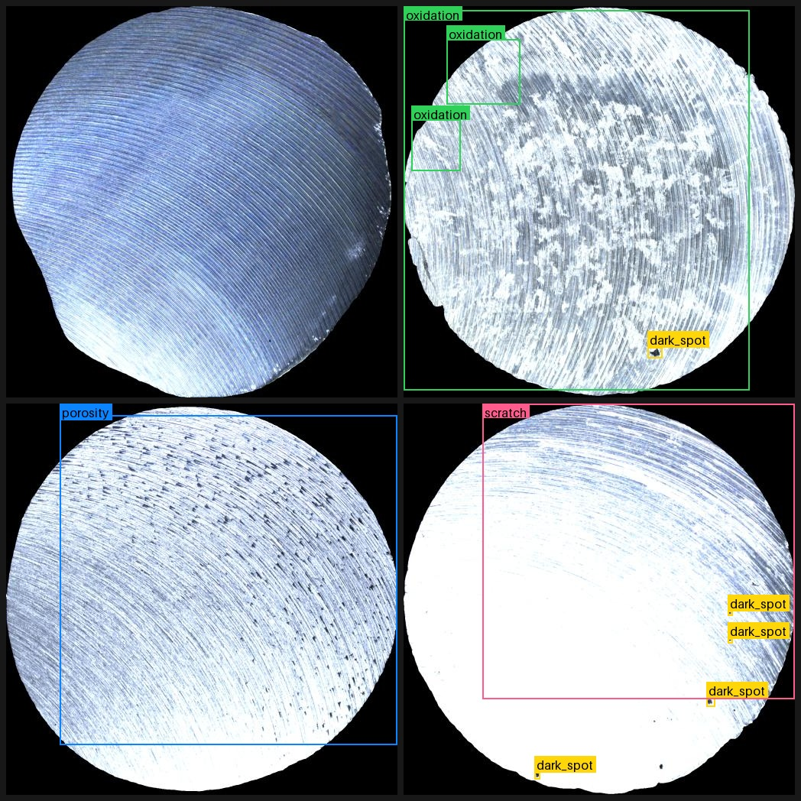
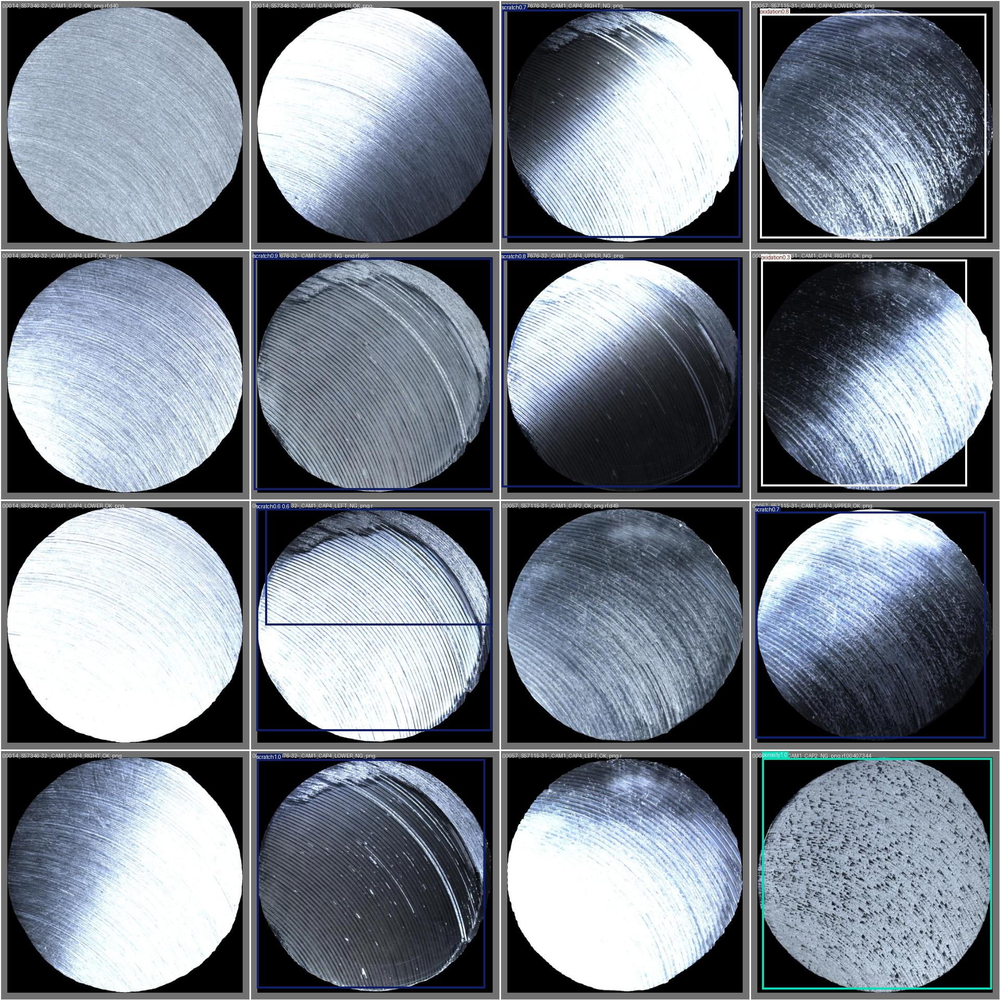
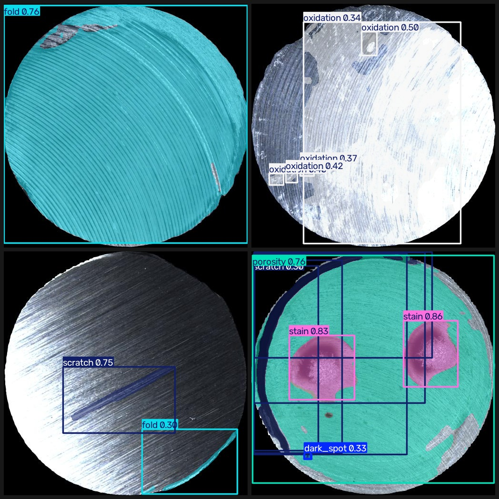

# DefectVision

**在公开数据集上微调一个表面缺陷检测模型，并把「基线 → 微调 → 量化 → 部署」的每一步都用同一套验证集量出来。**

默认数据集是 [MSDD](https://huggingface.co/datasets/rltjr/metal-surface-defect-v1)（金属零件表面缺陷，6 类，1,300 张），
全流程一条命令可复现；换成你自己的产线数据只需改一个 YAML。

<!-- 徽章：推到 GitHub 后换成你自己的地址
[](https://github.com/nine-Rain/defectvision/actions/workflows/ci.yml)
-->

## 为什么做这个

现成模型在**你的**场景上通常不够用：类别不认识、小目标漏检、光照一变就崩。
但"从头训一个模型"既慢又没必要。这个项目的思路是：

> 先用 COCO 预训练权重拿到零样本基线 → 用领域数据微调 → 量化上端侧 →
> 用同一套验证集把每一步的收益和代价都量出来。

所以它产出的不是"一个模型"，而是**一张能被追问的证据表**。

## 数据集：MSDD

| 项 | 值 |
| --- | --- |
| 内容 | 金属圆件表面照片，512×512，6 类缺陷 |
| 划分 | train 1,195 / val 150 / test 150（**按零件划分**，同一零件的多角度不会跨 split） |
| 负样本 | 244 张正常样本（空标签） |
| 标签 | YOLO 多边形格式；训练检测模型时 Ultralytics 自动转成外接框 |
| 许可 | CC BY 4.0（可商用，需署名） |
| 来源 | Roboflow Universe `msdd/msdd-prompt-learning-qjz4o` → HF 清理版 |

| id | 类别 | 中文 | 训练集实例数 |
| --- | --- | --- | ---: |
| 0 | dark_spot | 暗斑 | 537 |
| 1 | fold | 折叠 | 296 |
| 2 | oxidation | 氧化 | 373 |
| 3 | porosity | 气孔 | 593 |
| 4 | scratch | 划痕 | 1,466 |
| 5 | stain | 污渍 | 255 |



*用 `python scripts/preview_dataset.py --n 4` 生成。左上为正常样本（空标签），其余是缺陷标注。*

一个能解释指标的现象：标注框普遍很"松"——`porosity` 和 `scratch` 常直接框住大半个零件。
所以 mAP50（0.56）和 mAP50-95（0.38）差了近 20 个点：**模型大致找对了位置，但贴不紧边界**。
这不是模型不行，是标签本身的定位精度就到这儿。

数据本身**不进 git**：`python scripts/fetch_dataset.py` 会从镜像拉取（约 72 MB，支持断点续传），
并在 `data/msdd/SOURCE.md` 里写明出处与许可。

## 结果



*左图：真实标注；右图：模型预测（`runs/baseline/val_batch0_pred.jpg`）。*

### 精度（test split，150 张，全程未参与训练）

| 方案 | mAP50 | mAP50-95 | Precision | Recall | 体积 (MB) |
| --- | ---: | ---: | ---: | ---: | ---: |
| yolo11n 微调 50ep @512 | 0.559 | 0.384 | 0.668 | 0.530 | 5.24 |
| └ 导出 ONNX fp32 | 0.561 | 0.376 | 0.699 | 0.523 | 10.12 |
| └ 导出 ONNX INT8 | 0.560 | 0.376 | 0.667 | 0.532 | **2.88** |

> 这张表由 `results/metrics.md` 生成，不是手抄的：`python -m src.evaluate --compare`。

### 延迟（i9-12900HX / RTX 4060 8G，imgsz=512，50 次取分位）

| 模型 | 设备 | p50 (ms) | p95 (ms) | FPS |
| --- | --- | ---: | ---: | ---: |
| best.pt | RTX 4060 | **9.62** | 12.74 | 101 |
| best.pt | CPU | 36.11 | 41.00 | 28 |
| best.onnx (fp32) | CPU | 21.33 | 22.92 | 48 |
| best.onnx (INT8) | CPU | 44.00 | 47.74 | 23 |

三个结论，都能在面试里展开讲：

1. **ONNX 在 CPU 上比 PyTorch 快 40%**（21.3 vs 36.1ms）——图优化和算子融合是实打实的。
2. **INT8 体积降到 1/3.5、精度几乎不掉，但在 CPU 上反而慢了约一倍**。
   小模型 + 无 VNNI 加速时，反量化开销盖过了算力收益。**量化不是免费的，必须实测**。
3. GPU 上 p50 9.6ms，对应约 100 FPS，产线节拍要求 30 FPS 的话余量很大。
   如果真要上端侧（ARM/树莓派），应该重新导出 OpenVINO / NCNN，而不是拿这份 CPU 数据外推。


## 检测 vs 分割

标签原本就是多边形，所以同一份数据既能转成框训检测，也能直接训分割。两个模型都是 50 轮、512 输入、同一套 test：

| 模型 | 任务 | mAP50 | mAP50-95 | 体积 | 后处理 |
| --- | --- | ---: | ---: | ---: | ---: |
| yolo11n | 检测（框） | 0.559 | **0.384** | 5.24 MB | 1.4 ms |
| yolo11n-seg | 分割（框） | 0.581 | — | 5.75 MB | 3.9 ms |
| yolo11n-seg | 分割（掩码） | **0.580** | 0.343 | 5.75 MB | 3.9 ms |



三个观察：

1. **IoU=0.5 时分割略胜**（0.580 vs 0.559）。掩码只要能"盖住"缺陷就算命中，比框更宽容。
2. **高 IoU 时反而更低**（0.343 vs 0.384）。掩码边界比矩形难贴合得多，而且这张数据集的 GT 多边形本身就画得松。
3. **最该讲的一条**：左上角那张，`fold` 的掩码把整个零件都盖住了，置信度还有 0.76。
   第一反应是"模型坏了"，但回头看标注——训练集里 `fold` 的 GT 就是这么标的大块区域。
   **数据的上限就是模型的上限**，这句话在这里是可验证的，不是套话。

代价也很实在：分割的后处理 3.9ms vs 检测 1.4ms，模型多 26 万参数。**要不要分割，取决于你的下游是"数个数"还是"量面积"**——只做计数和定位，检测足够。

## 快速开始

```bash
git clone https://github.com/nine-Rain/defectvision.git
cd defectvision

python -m venv .venv
# Windows: .venv\Scripts\activate
# macOS/Linux: source .venv/bin/activate
pip install -e ".[train,demo,dev]"
# 国内网络如果 pip 卡在依赖解析，见 docs/troubleshooting.md 第 1 条

# 1. 预训练权重（GitHub 被拦时用镜像）
python scripts/fetch_weights.py --model yolo11n.pt

# 2. 数据集（约 72 MB）
python scripts/fetch_dataset.py

# 3. 数据体检：标签格式 + 类别分布 + 跨 split 泄漏
python -m src.prepare stats --config configs/dataset.msdd.yaml
python -m src.prepare dups  --config configs/dataset.msdd.yaml

# 4. 冒烟训练（1 epoch，1 分钟内）
python -m src.train --smoke

# 5. 正式训练 + 评估 + 对比表
python -m src.train
python -m src.evaluate --weights runs/baseline/weights/best.pt --tag baseline --note "yolo11n 微调"
python -m src.evaluate --compare

# 6. Demo
python -m src.app --weights runs/baseline/weights/best.pt
```

打开 <http://127.0.0.1:7860>，上传一张图就能看到框、置信度和耗时。

## 换成你自己的数据

1. **采集**：≥ 500 张，其中约 10% 是负样本（无缺陷的正常品）。
   光照、角度、距离要贴近实际使用场景。
2. **标注**：[Label Studio](https://labelstud.io/) 或 [Roboflow](https://roboflow.com/)，导出 YOLO 格式。
   规范见 [docs/labeling.md](docs/labeling.md)——**先读再标**，能省一轮返工。
3. **摆目录**：

```
data/dataset/
├── images/{train,val,test}/
└── labels/{train,val,test}/     # 与图片同名 .txt；负样本留空文件
```

4. **体检**：改 `configs/dataset.yaml` 的 `path` 和 `names`，然后跑 `prepare stats` / `prepare dups`。
5. **训练**：`python -m src.train --dataset configs/dataset.yaml`。

## 命令速查

| 目的 | 命令 |
| --- | --- |
| 下载数据集 | `python scripts/fetch_dataset.py` |
| 下载权重 | `python scripts/fetch_weights.py --model yolo11n.pt` |
| 看标注长什么样 | `python scripts/preview_dataset.py --n 4` |
| 看预测长什么样 | `python scripts/preview_prediction.py --weights runs/baseline/weights/best.pt` |
| 数据体检 | `python -m src.prepare stats --config configs/dataset.msdd.yaml` |
| 查重复/泄漏 | `python -m src.prepare dups --config configs/dataset.msdd.yaml` |
| 切分平铺数据 | `python -m src.prepare split --src data/raw --out data/dataset` |
| 冒烟训练 | `python -m src.train --smoke` |
| 正式训练 | `python -m src.train --name baseline` |
| 训练分割版 | `python -m src.train --model yolo11n-seg.pt --name baseline-seg` |
| 续训 | `python -m src.train --resume runs/baseline/weights/last.pt` |
| 评估 | `python -m src.evaluate --weights <path> --tag <name>` |
| 重建对比表 | `python -m src.evaluate --compare` |
| 导出 ONNX | `python -m src.export --weights <path>` |
| INT8 量化 | `python -m src.export --weights <path> --int8` |
| 延迟基准 | `python -m src.benchmark --weights models/baseline_int8.onnx` |
| 启动 Demo | `python -m src.app --weights <path>` |

## 项目结构

```
defectvision/
├── configs/
│   ├── dataset.msdd.yaml   # 公开数据集（默认）
│   ├── dataset.yaml        # 你自己的数据（模板）
│   └── train.yaml          # 超参
├── scripts/
│   ├── fetch_dataset.py    # 从 HF 镜像拉数据集，断点续传
│   ├── fetch_weights.py    # 从 HF 镜像拉预训练权重
│   ├── preview_dataset.py  # 把标注画到图上，检查标注质量
│   ├── preview_prediction.py # 跑几张图，拼成预览图
│   └── make_demo_dataset.py# 造合成数据，离线也能跑通
├── src/
│   ├── config.py           # 配置加载 / 校验 / 路径解析
│   ├── prepare.py          # 数据体检 / 去重 / 切分
│   ├── train.py            # 训练
│   ├── evaluate.py         # 评估 + 自动汇总对比表
│   ├── export.py           # ONNX / INT8 导出
│   ├── benchmark.py        # p50/p95 延迟与体积
│   └── app.py              # Gradio Demo
├── tests/                  # 不装 torch 也能跑
├── docs/
│   ├── labeling.md         # 标注规范
│   ├── roadmap.md          # 六周计划 + 面试自检
│   ├── publish.md          # 推到 GitHub 的步骤
│   └── troubleshooting.md  # 环境问题对照表
└── results/                # 指标 json + metrics.md（提交）
```

## 踩过的坑（真实记录）

| 现象 | 猜测 | 验证 | 结论 |
| --- | --- | --- | --- |
| 数据集只下了 1,997 个文件，train 只有 847 张 | 仓库本身不全 | 对比 HF 的 `siblings` 列表，应有 2,993 个 | `tree?recursive=true` **每页最多 1000 条**，被静默截断；改用 `siblings` |
| 评估报 `images not found`，路径里多出 `datasets/` | 配错了 path | 发现 ultralytics 把相对 path 拼到 `settings.datasets_dir` | 传参前统一改写成绝对路径（`materialize_dataset`） |
| 对比表里 mAP50 一列全是 `—` | 指标键名不对 | 打印 `results_dict` 的 key | 取值逻辑写成了 `all()`（要求同时含 `(B)` 和 `(M)`），应为精确匹配 |
| `pip install ultralytics` 卡 10 分钟，CPU 100% | 网速慢 | 网络正常，是解析器回溯 | 换 `uv`，秒装 |
| 下载权重报证书错误 | 缺 CA | 换 certifi 仍失败 | 链路有中间人；改从 HF 镜像取官方权重 |
| 训练集提示 "2 duplicate labels removed" | 数据脏 | 同一张图里框完全重合 | Ultralytics 自动去重，无需处理，但要记在心里 |
| 导出 ONNX 后延迟从 2ms 变 14ms，以为量化把模型搞坏了 | 导出有问题 | 发现 `.pt` 跑 GPU、`.onnx` 跑 CPU | 基准必须固定设备，否则结论全是假的 |
| INT8 比 FP32 还慢一倍（44 vs 21ms） | 量化必然更快 | 同设备复测仍然如此 | 小模型 + CPU 无 VNNI，反量化开销主导；要提速得换 OpenVINO / NCNN |
| 对比表里混进 `export_*.json`，多出两行 `?` | 表格读错文件 | 看到那几个 json 没有 `tag` 字段 | 导出清单不是评估结果，读表时按 `tag` 过滤 |
| 本地 `ruff` 全绿，CI 却挂在 lint | 版本不一致 | 在干净 clone 里复现，发现仓库根目录多了 `gradio/` 和 `Ultralytics/` | 目录名与包名只差大小写，ruff 把 `gradio`/`ultralytics` 误判为**本地模块**；把缓存目录移出仓库根目录 |
| Demo 上传的私人图片被 `git add -A` 提交进公开仓库 | — | `git ls-files` 里出现 `gradio/<hash>/微信图片_*.png` | 缓存目录必须在 `.gitignore` 里；提交前先看 `git status`。已用 `filter-branch` 从历史中清除并强推 |

## 常见问题

**Q：必须用 GPU 吗？**
冒烟和推理 CPU 可以跑（慢）。正式训练建议 ≥ 6GB 显存的卡；本项目在 4060 Laptop 8G 上
跑 yolo11n @ 512 / batch 16 只占约 1.5GB。

**Q：能改成分割吗？**
可以，而且 MSDD 的标签本来就是多边形：`--model yolo11n-seg.pt`，评估脚本会自动匹配 `(M)` 指标。

**Q：数据能放仓库里吗？**
别。用 `scripts/fetch_dataset.py` 让下载可复现，仓库只存脚本和许可说明。

**Q：为什么不用 MMDetection / Detectron2？**
可以，但本项目的目标是"尽快出可用的 demo + 可讲的指标"，Ultralytics 的工程链路最短。
换框架是加分项，不是起点。

**Q：装环境报错了怎么办？**
先看 [docs/troubleshooting.md](docs/troubleshooting.md)，里面按症状列了这台机器实际踩过的坑。

## License

代码 [MIT](LICENSE)；数据集 CC BY 4.0，使用时请保留 `data/msdd/SOURCE.md` 中的署名。
