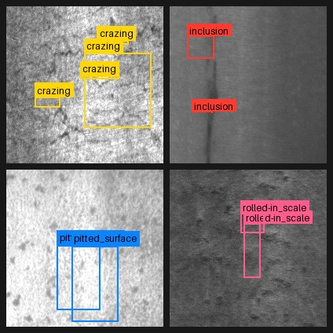
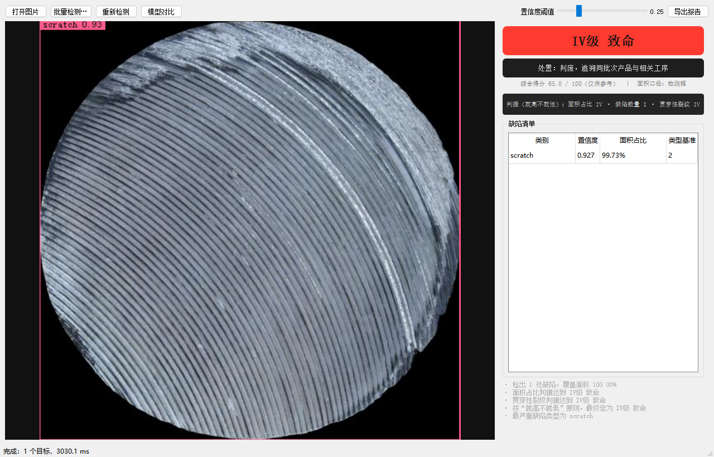
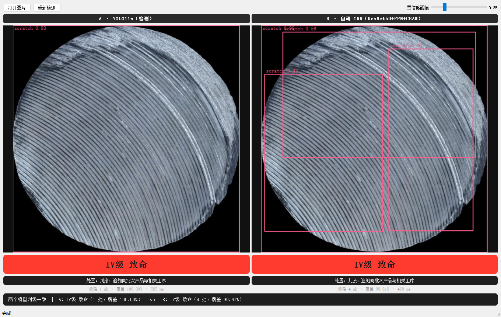

# DefectVision

**同一份数据，两条技术路线，一个能交付的系统。**

| 线 | 内容 | 产物 |
| --- | --- | --- |
| 快线 | YOLO11n 微调 → ONNX 量化 → 网页 Demo | mAP50 **0.559**，INT8 后 2.88 MB |
| 深线 | ResNet50 + FPN + CBAM 自研检测器，与 YOLO 同台对比 | CBAM 消融实验 |
| 系统 | 缺陷四级判定 + PyQt5 桌面端 | 导入 → 检测 → 分级 → 报告 |

默认数据集是 [MSDD](https://huggingface.co/datasets/rltjr/metal-surface-defect-v1)（金属零件表面缺陷，6 类，1,300 张），
另一份 NEU-DET（热轧钢带）用同一条命令接入；换成你自己的产线数据只需改一个 YAML。

<!-- 徽章：推到 GitHub 后换成你自己的地址
[](https://github.com/nine-Rain/defectvision/actions/workflows/ci.yml)
-->

## 为什么做这个

现成模型在**你的**场景上通常不够用：类别不认识、小目标漏检、光照一变就崩。
这个项目不满足于"跑通一个 YOLO"，而是要把三件事都做成可交付：

1. **能用**：一条命令下载数据、训练、量化、起界面；
2. **能讲**：每个结论都有对照实验，指标由脚本生成而不是手抄；
3. **能查**：判级规则可解释、可配置，产线改阈值不用重训模型。

## 数据集：MSDD

| 项 | 值 |
| --- | --- |
| 内容 | 金属圆件表面照片，512×512，6 类缺陷 |
| 划分 | train 1,195 / val 150 / test 150（**按零件划分**，同一零件的多角度不会跨 split） |
| 负样本 | 244 张正常样本（空标签） |
| 标签 | YOLO 多边形格式；训练检测模型时 Ultralytics 自动转成外接框 |
| 许可 | CC BY 4.0（可商用，需署名） |
| 来源 | Roboflow Universe `msdd/msdd-prompt-learning-qjz4o` → HF 清理版 |

| id | 类别 | 中文 | 训练集实例数 |
| --- | --- | --- | ---: |
| 0 | dark_spot | 暗斑 | 537 |
| 1 | fold | 折叠 | 296 |
| 2 | oxidation | 氧化 | 373 |
| 3 | porosity | 气孔 | 593 |
| 4 | scratch | 划痕 | 1,466 |
| 5 | stain | 污渍 | 255 |


*用 `python scripts/preview_dataset.py --n 4` 生成。左上为正常样本（空标签），其余是缺陷标注。*

一个能解释指标的现象：标注框普遍很"松"——`porosity` 和 `scratch` 常直接框住大半个零件。
所以 mAP50（0.56）和 mAP50-95（0.38）差了近 20 个点：**模型大致找对了位置，但贴不紧边界**。
这不是模型不行，是标签本身的定位精度就到这儿。

数据本身**不进 git**：`python scripts/fetch_dataset.py` 会从镜像拉取（约 72 MB，支持断点续传），
并在 `data/msdd/SOURCE.md` 里写明出处与许可。

### 第二份数据：NEU-DET（热轧钢带）

用于验证方法能不能跨场景迁移。1800 张 200×200，同样 6 类，YOLO 框标签：

| 划分 | 数量 | 框数 |
| --- | ---: | ---: |
| train | 1,458 | 3,365 |
| val | 162 | 378 |
| test | 180 | 446 |



```bash
python -m src.prepare stats --config configs/dataset.neu-det.yaml
python -m src.train --dataset configs/dataset.neu-det.yaml --imgsz 320 --name neu-yolo
```

> 官方页面（[东北大学宋克臣课题组](http://faculty.neu.edu.cn/songkechen/zh_CN/zhym/263269/list/index.htm)）
> 只提供申请下载；仓库里用的是 GitHub 上的 YOLO 整理版，经代理下载后重新切了 val。
> 两份数据的缺陷形态差异很大（圆件 vs 钢带），跨数据集结果才有说服力。

## 结果


*左图：真实标注；右图：模型预测（`runs/baseline/val_batch0_pred.jpg`）。*

### 精度（test split，150 张，全程未参与训练）

| 方案 | mAP50 | mAP50-95 | Precision | Recall | 体积 (MB) |
| --- | ---: | ---: | ---: | ---: | ---: |
| yolo11n 微调 50ep @512 | 0.559 | 0.384 | 0.668 | 0.530 | 5.24 |
| └ 导出 ONNX fp32 | 0.561 | 0.376 | 0.699 | 0.523 | 10.12 |
| └ 导出 ONNX INT8 | 0.560 | 0.376 | 0.667 | 0.532 | **2.88** |

> 这张表由 `results/metrics.md` 生成，不是手抄的：`python -m src.evaluate --compare`。

### 跨数据集：同一套代码，换一份数据

| 数据集 | 模型 | test mAP50 | test mAP50-95 |
| --- | --- | ---: | ---: |
| MSDD（金属圆件，512×512） | yolo11n 50ep @512 | 0.559 | **0.384** |
| MSDD | ResNet50+FPN+CBAM 50ep+增强 @512 | **0.574** | 0.298 |
| NEU-DET（热轧钢带，200×200） | yolo11n 50ep @320 | **0.749** | **0.404** |
| NEU-DET | ResNet50+FPN+CBAM 20ep @320 | 0.667 | 0.299 |

三点观察：

1. **NEU-DET 好做得多**（0.749 vs 0.559）。缺陷与背景对比度高、同类形态统一。
   分类型看 `crazing`（龟裂，纹理型）只有 0.37，`patches`（斑块）到 0.93——
   **纹理型缺陷比区域型难检**，和 MSDD 上 `scratch` 最弱完全一致。
2. **自研模型在 MSDD 上 mAP50 反超 YOLO（0.574 vs 0.559），但 mAP50-95 明显更低**
   （0.298 vs 0.384）。说明它"找得到缺陷、贴不紧边界"——两阶段模型的定位精度是短板。
3. 增强带来的提升很实在：同一个模型从 0.476/0.248 涨到 0.574/0.298。
   **在数据量只有 1.2k 时，增强比换结构划算得多。**

### 分级实验：mAP 不能代表"能不能用"

检测指标只回答"框得准不准"，但系统真正交付的是**判级**。所以又做了一组实验：
用标注框按同一套规则算出"参考等级"，再和模型判出的"系统等级"比。
MSDD test，150 张，置信度阈值 0.25：

强调：下面三行都是"框面积"口径（参考等级也用框算），口径一致才可比。
YOLO11n-seg 那行用"掩码面积"口径，单独列出仅作参照。

| 模型 | mAP50 | 完全一致率 | ±1 级内 | IV 级召回 | 低等级误杀率 |
| --- | ---: | ---: | ---: | ---: | ---: |
| RT-DETR-l | **0.641** | 81.3% | 83.3% | **99.0%** | 28.1% |
| YOLOv8s | 0.588 | **83.3%** | **86.7%** | 93.9% | **6.2%** |
| YOLO11n | 0.559 | 82.7% | 84.7% | 92.9% | 9.4% |
| ResNet50+FPN+CBAM（50ep+增强） | 0.574 | 73.3% | 75.3% | 94.9% | 59.4% |
| ResNet50+FPN+CBAM（20ep） | 0.476 | 65.3% | 66.7% | 98.0% | 93.8% |
| YOLO11n-seg（掩码口径） | 0.580 | 79.3% | **87.3%** | 93.2% | **5.3%** |

**这是整个项目里最反直觉的一组数字**：

- **RT-DETR 检测最强（mAP50 0.641），判级却不是第一**（81.3%，低于 YOLOv8s 的 83.3%），
  误杀率 28.1% 是 YOLOv8s 的 4.5 倍；
- 自研 CNN 的 mAP50（0.574）**高于** YOLO11n（0.559），但判级一致率低 9 个百分点，
  误杀率是它的 **6 倍**（59.4% vs 9.4%）；
- 误杀的意思是：正常件/轻微缺陷被判成"严重"。产线上等于**把好件当废品**；
- ±1 容忍几乎兜不住错误（只多 1~2 个点），说明错误是**跨级**的，不是差一点。

**结论：mAP 排名和判级可用性没有对应关系。** 两个检测能力不同的模型（RT-DETR 与自研 CNN），
都在同一个地方翻车——框的输出方式（数量、松紧）直接决定了判级结果。

### 调参实验：阈值能救多少？

把置信度阈值从 0.25 往上调，误杀会降，但 IV 召回也会掉——**这不是免费的**：

| 阈值 | YOLO11n 一致率 | 误杀率 | IV 召回 | CNN 一致率 | 误杀率 | IV 召回 |
| ---: | ---: | ---: | ---: | ---: | ---: | ---: |
| 0.25 | **82.7%** | 9.4% | 92.9% | 73.3% | 59.4% | 94.9% |
| 0.40 | 79.3% | 3.1% | 85.7% | 76.0% | 50.0% | 94.9% |
| 0.55 | 73.3% | 3.1% | 78.6% | 77.3% | 34.4% | 93.9% |

读出来的两件事：

1. **YOLO 调阈值是"换"不是"赚"**：误杀 9.4%→3.1%，代价是 IV 召回 92.9%→85.7%。
   漏判致命缺陷比误杀正常件更贵，所以 0.25 反而更合理。
2. **CNN 调阈值只能缓解症状**：59.4%→34.4%，仍然不可用。
   它的病根是框住整张图，不是阈值。

**RT-DETR 对阈值最敏感，必须单独标定工作点**：

| conf | 一致率 | 误杀率 | IV 召回 |
| ---: | ---: | ---: | ---: |
| 0.25 | 81.3% | 28.1% | **99.0%** |
| 0.40 | 79.3% | 15.6% | 93.9% |
| 0.55 | **83.3%** | **3.1%** | 92.9% |
| 0.70 | 77.3% | 0.0% | 85.7% |

它默认输出大量低分框（DETR 系无 NMS），这些框会把面积撑大、把等级推高。
0.55 是它最平衡的工作点（83.3% / 3.1%），**但这与 YOLO 的最优阈值（0.25）差了 0.3**——
所以"用同一个阈值横评多个模型"是错的，必须各自标定。

> 顺带排除了一个猜测：判级前加 NMS（IoU 0.5）对误杀率**没有影响**（28.1%→28.1%），
> 说明误杀不是重复框造成的，而是**低分误检**。这也是为什么该调 conf 而不是 NMS。

### 判级阈值校准：几乎没用

把面积/数量阈值在 val 上做 216 组网格搜索（参考等级固定按开题阈值算，只调系统侧），
再到 test 上验证：

| 模型 | 校准前一致率 | 校准后一致率 | 说明 |
| --- | ---: | ---: | --- |
| YOLOv8s | 83.3% | **84.0%** | +0.7pp，落在 val→test 的波动范围内 |
| YOLO11n | 82.7% | 82.0% | −0.7pp，换一组阈值反而更差 |
| 自研 CNN | 73.3% | 73.3% | 无变化，误杀反而 59.4%→62.5% |

结论：**开题的默认阈值已经接近最优，调阈值救不了系统**。
这也侧面说明当初的阈值设计是合理的——但更重要的是，
**模型误差是结构性的（检出的框就不对），不是决策边界画歪了**。

### 置信度加权面积：也没用（又一个负结果）

直觉上，0.3 分的误检不该和 0.9 分的真缺陷等权计入面积。于是把面积从"二值并集"
改成"每个像素取最高置信度再累加"，实测：

| 模型 | 二值面积 | 置信度加权 | 误杀率 |
| --- | ---: | ---: | ---: |
| YOLOv8s | **83.3%** | 80.7% | 6.2% → 6.2% |
| RT-DETR-l | **81.3%** | 78.0% | 28.1% → 28.1% |
| 自研 CNN | **73.3%** | 72.7% | 59.4% → 59.4% |

**三个模型一致：一致率下降，误杀率纹丝不动。**

原因很直接：把正常件推成 IV 级的那些框，置信度本来就有 0.7~0.9。
乘以 0.8 之后面积只缩水两成，照样越过 5% 的阈值——**加权改变不了定性结论**。

所以这个开关默认关掉（`area_weighting: binary`），代码保留，用于复现这条负结果。

> 到这里，"在判级公式上做文章"这条路基本走到头了：
> 阈值校准无效、面积加权无效、NMS 后处理无效。
> 真正有效的只有两件事：**换面积口径（掩码）** 和 **标定置信度工作点**。

### 目视复核 42 张误杀样本：93% 确认是模型误检

把四个模型里"判级比标注高 ≥2 级"的样本挑出来，拼成 11 张复核图逐张看
（`docs/review/`），再由作者独立判读一遍，两边结果合并：

| 判定 | 数量 | 占比 |
| --- | ---: | ---: |
| **模型误检** | **39** | **93%** |
| 标注漏标 | 3 | 7% |
| 存疑 | 0 | 0% |

两个人都看出的失败模式：

- **81%（34/42）的图里，模型输出框的总面积超过图像 40%**，几乎盖住整个零件；
- 但这些图**大多确实有真实缺陷**（标注框可见，模型也检出来了）；
- 失败模式不是"无中生有"，而是**在正确检出之外多画了一个整体框**，把面积撑到 100%+。

**关键结论：误杀率不是被标签噪声吹大的，模型确实在过度检测。**
只有 3 张属于"标注漏标"——模型是对的，却因为标注没标而被记成误杀。

顺着"整体框"的结论加了过滤规则，结果适得其反：

| 模型 | 一致率 | IV 召回 | 误杀率 |
| --- | ---: | ---: | ---: |
| RT-DETR（过滤前） | **81.3%** | **99.0%** | 28.1% |
| RT-DETR（过滤后） | 65.3% | 64.3% | 18.8% |
| YOLOv8s（过滤前） | **83.3%** | **93.9%** | 6.2% |
| YOLOv8s（过滤后） | 60.0% | 57.1% | 3.1% |

**误杀降了，IV 召回崩了**——MSDD 里真实的严重缺陷本身就是大面积，一刀切会连真缺陷一起删。

**这是第五个失败的"公式层"修补**，而且它揭示了根本矛盾：

> 参考等级和模型输出用的是**同一套"框面积"语义**。
> 任何收紧规则的改动，都会同时让模型偏离真实大缺陷。
> **只要标准还是"框面积"，怎么调都是在自证。**

| 尝试 | 结果 |
| --- | --- |
| 判级阈值网格校准（216 组） | ❌ ±0.7pp |
| NMS 后处理 | ❌ 无变化 |
| 置信度加权面积 | ❌ 一致率反降 |
| 整体框过滤 | ❌ 伤 IV 召回 |
| 难负样本重训 | ❌ 六项指标五项变差 |
| **掩码面积口径** | ✅ 误杀 9.4%→5.3% |
| **置信度工作点标定** | ✅ RT-DETR 误杀 28.1%→3.1% |

### 难负样本重训：也失败了（最意外的一次）

既然误杀来自"整体框"，最直接的修法就是喂负样本：把"有纹理、没缺陷"的表面当背景教给模型。

数据构造（`scripts/make_hard_negatives.py`）：

| 来源 | 数量 | 说明 |
| --- | ---: | --- |
| 缺陷图的干净区域裁片 | 162 | 与任何标注框不相交的 320~512 px 区域 |
| 纯背景件旋转/翻转增广 | 549 | 直接对应"整件无缺陷" |
| MSDD 原始训练集 | 1195 | 含 183 张背景 |
| **合计** | **1906**（负样本 37%） | |

裁片只凑到 162 张——因为 MSDD 的缺陷框太大，一张图里几乎没有 320px 以上的干净区域，
这本身也印证了"整体框"的来源。

**训练前先定死验收红线，结果四条全破：**

| 指标 | 基线 | 加难负样本 | 变化 | 红线 | 判定 |
| --- | ---: | ---: | ---: | ---: | :--: |
| 低等级误杀率 | 9.4% | 28.1% | +18.7 | ≤6% | ❌ |
| IV 级召回 | 92.9% | 87.8% | −5.1 | ≥90% | ❌ |
| 判级一致率 | 82.7% | 74.7% | −8.0 | ≥82% | ❌ |
| mAP50 | 0.559 | 0.530 | −2.9 | ≥0.545 | ❌ |
| mAP50-95 | 0.384 | 0.336 | −4.8 | — | — |

**误杀率不但没降，反而从 9.4% 涨到 28.1%。**

这个结果推翻了一个很自然的假设：**"整体框"不是数据不平衡造成的**。
加了 37% 的负样本，模型对大面积纹理反而更敏感了。

可能的解释：负样本是 320~512 的裁片，训练时被缩放到 512，
与整图推理时的尺度不一致；同时 37% 的背景图稀释了正样本的梯度。

**结论：检测端也不是"加数据就能修"的。** 到此为止，能想到的修补都试过了：

| 层 | 手段 | 结果 |
| --- | --- | --- |
| 判级规则 | 阈值校准 / 加权 / 尺寸过滤 | ❌ 全部无效 |
| 后处理 | NMS | ❌ 无效 |
| 训练数据 | 难负样本 | ❌ 全面变差 |
| 面积口径 | 掩码像素 | ✅ 唯一稳定的改进 |
| 运行参数 | 置信度工作点 | ✅ 有效 |

剩下唯一没试、且理论上能打破"自证"循环的，只有**人工标注真实等级**。

### 提高分辨率：mAP 涨了，判级反而崩了

同一模型（YOLO11n）、同一份数据，只改输入尺寸：

| 输入 | mAP50 | mAP50-95 | p50 | 判级一致率 | IV 召回 | 误杀 |
| --- | ---: | ---: | ---: | ---: | ---: | ---: |
| 512 | 0.559 | 0.384 | 12.3 ms | **82.7%** | **92.9%** | 9.4% |
| 640 | **0.590** | 0.387 | 14.5 ms | 74.7% | 81.6% | 0.0% |
| 640 + 阈值校准 | — | — | — | 75.3% | 82.7% | 0.0% |

三个数字放一起看：

1. **mAP50 +3.1pp，但 mAP50-95 只 +0.3pp**——提高分辨率提升的是"找到缺陷"，
   不是"贴准边界"；
2. **判级一致率掉 8pp、IV 召回掉 11pp**。原因是框变紧了：面积变小 → 等级被系统性低估 →
   漏判致命件；
3. 重新校准阈值只救回 0.6pp，**救不回来**。

**这说明判级系统对"框的松紧"极其敏感**——同一套阈值，换个输入尺寸就失效。
想稳定，只能把面积口径换成与模型无关的物理量（掩码像素），或者每换一个模型就重标定一次。

结论：**检测指标高 ≠ 系统可用**。要暴露这个问题，必须做分级实验——
这也正是开题答辩时老师说的"很少有人做、有价值"的方向。

```bash
python -m src.evaluate_grading --weights runs/yolov8s/weights/best.pt --split test --tag yolo8s-grading
```

### 性能与体积（RTX 4060 8G，imgsz=512，50 次取分位）

| 模型 | 参数量 | 体积 | p50 (ms) | p95 (ms) | FPS |
| --- | ---: | ---: | ---: | ---: | ---: |
| RT-DETR-l | 32.8 M | 63.1 MB | 22.5 | 27.0 | 44 |
| YOLOv8s | 11.1 M | 21.5 MB | 12.0 | 15.4 | 88 |
| YOLO11n | 2.6 M | 5.2 MB | 12.3 | 15.0 | 69 |
| ResNet50+FPN+CBAM | 41.4 M | 158.3 MB | 34.3 | 37.3 | 28 |

**检测精度最高的 RT-DETR 也是最慢的之一**（22.5ms，是 YOLOv8s 的 1.9 倍）。
自研模型慢 3 倍、大 30 倍——两阶段检测器的代价就在这里。
**精度没赢，速度输一倍，体积输 30 倍**，这是必须写进论文的诚实结论。

如果要上产线，权衡很清楚：**YOLOv8s 是精度/速度的拐点**（0.588 / 12ms），
RT-DETR 多 6 个点精度、慢一倍，自研 CNN 两头都不占。

## 检测 vs 分割

标签原本就是多边形，所以同一份数据既能转成框训检测，也能直接训分割。两个模型都是 50 轮、512 输入、同一套 test：

| 模型 | 任务 | mAP50 | mAP50-95 | 体积 | 后处理 |
| --- | --- | ---: | ---: | ---: | ---: |
| yolo11n | 检测（框） | 0.559 | **0.384** | 5.24 MB | 1.4 ms |
| yolo11n-seg | 分割（框） | 0.581 | — | 5.75 MB | 3.9 ms |
| yolo11n-seg | 分割（掩码） | **0.580** | 0.343 | 5.75 MB | 3.9 ms |


三个观察：

1. **IoU=0.5 时分割略胜**（0.580 vs 0.559）。掩码只要能"盖住"缺陷就算命中，比框更宽容。
2. **高 IoU 时反而更低**（0.343 vs 0.384）。掩码边界比矩形难贴合得多，而且这张数据集的 GT 多边形本身就画得松。
3. **最该讲的一条**：左上角那张，`fold` 的掩码把整个零件都盖住了，置信度还有 0.76。
   第一反应是"模型坏了"，但回头看标注——训练集里 `fold` 的 GT 就是这么标的大块区域。
   **数据的上限就是模型的上限**，这句话在这里是可验证的，不是套话。

代价也很实在：分割的后处理 3.9ms vs 检测 1.4ms，模型多 26 万参数。**要不要分割，取决于你的下游是"数个数"还是"量面积"**——只做计数和定位，检测足够。

## 改进模型：ResNet50 + FPN + CBAM

除了拿 YOLO 当强基线，仓库里还有一条**自己搭的检测器**，对应论文里的"改进 CNN 模型层"：

```
输入 512×512
  └─ ResNet50（layer1~layer4 → C2/C3/C4/C5）
  └─ FPN：自顶向下融合 + 3×3 平滑，统一 256 通道，5 个尺度
  └─ CBAM ×5：通道注意力（看什么）+ 空间注意力（看哪里）
  └─ RPN + ROI Align + 分类/回归头
```

| 组件 | 文件 | 作用 |
| --- | --- | --- |
| CBAM | `src/models/cbam.py` | 通道 + 空间注意力，逐层加权 FPN 特征 |
| 骨干 + FPN | `src/models/detector.py` | ResNet50 多尺度特征 + 金字塔融合 |
| 数据管道 | `src/data/yolo_dataset.py` | YOLO 标签（框或多边形）→ torchvision 输入 |
| 训练 | `src/train_cnn.py` | AMP、余弦退火、每轮 mAP 评估 |
| 评估 | `torchmetrics` + `faster-coco-eval` | 不用 pycocotools，Windows 上也能装 |

```bash
python -m src.train_cnn --name cnn-cbam --epochs 20          # 完整模型
python -m src.train_cnn --name cnn-nocbam --no-cbam --epochs 20   # 消融
python -m src.evaluate --compare                              # 进同一张对比表
```

**为什么不用"从零写一个网络"**：检测头的正负样本分配、anchor、NMS、损失平衡，
写错一个就训不起来，且和"改进点"无关。把变量控制在 backbone 上，消融实验才说得清——
这是能写进论文的取舍，也是答辩时最容易被追问的地方。

### 消融结果：CBAM 的效应落在噪声里

同一份 MSDD、同一张卡，只改 CBAM 开关。跑了四组：20 轮无增强 / 50 轮带增强。

| 配置 | 轮数 | 增强 | val mAP50 | val mAP50-95 | test mAP50 | test mAP50-95 |
| --- | ---: | :-: | ---: | ---: | ---: | ---: |
| ResNet50 + FPN | 20 | ✗ | **0.4530** | **0.2346** | **0.4935** | **0.2620** |
| ResNet50 + FPN + CBAM | 20 | ✗ | 0.4346 | 0.2234 | 0.4755 | 0.2475 |
| ResNet50 + FPN | 50 | ✓ | 0.5171 | 0.2850 | 0.5158 | 0.2749 |
| ResNet50 + FPN + CBAM | 50 | ✓ | 0.5066 | 0.2685 | **0.5741** | **0.2980** |

**结论是：CBAM 的效应不稳定，落在噪声里。**

- 20 轮无增强：无 CBAM 在 val 和 test 上都更好（-0.014 / -0.018）。
- 50 轮带增强：**val 上无 CBAM 更好（+0.017），test 上 CBAM 更好（-0.023）**——两个评估集结论相反。

val 和 test 各只有 150 张图，mAP 的抽样波动本来就有 ±0.02~0.03。
两次评估方向相反，说明这个量级的差异**不足以支撑任何结论**——既不能说 CBAM 有效，也不能说有害。

这段实验真正证明的是另外两件事：

1. **数据增强 + 更长训练是有效的**：同样的 CBAM 模型，mAP50 从 0.4346 涨到 0.5125（val +0.078）。
2. **小验证集上的单次消融不可信**：要做可信对比，必须固定种子、跑 3 个以上种子取均值±标准差。
   `--seed` 已经加进 `src/train_cnn.py`，之前的几次实验**没有固定种子**，这也是结论摇摆的原因之一。

```bash
# 想得到可发表的结论，至少这样跑
for s in 42 43 44; do
  python -m src.train_cnn --name cbam-s$s --seed $s --augment --epochs 50
  python -m src.train_cnn --name nocbam-s$s --no-cbam --seed $s --augment --epochs 50
done
```

**把这种"没有结论"的结果写进论文不是减分项**——它说明你真的做了对照、真的在看数字，
而不是挑一个好看的种子。答辩时这比"我的改进提升了 2 个点"更难被问倒。

完整的"流程图 → 代码"对照、实验设计和论文图表清单见 [docs/thesis.md](docs/thesis.md)。

## 缺陷分级 + 桌面端



检测只回答"有没有、在哪"，产线还要回答"**能不能放行**"。判级规则**严格按开题报告的定义实现**，
四个判据各自给级、取最高（就高不就低）：

| 等级 | 面积占比 | 缺陷数量 | 裂纹 | 处置 |
| --- | --- | --- | --- | --- |
| I 级 轻微 | ≤ 0.5% | ≤ 2 | 无 | 合格，放行留档 |
| II 级 中度 | 0.5% ~ 2% | 3 ~ 5 | 非贯穿性短裂纹 | 让步接收，返修后复检 |
| III 级 严重 | 2% ~ 5% | 6 ~ 10 | 长度超限 | 返工，二次全检 |
| IV 级 致命 | > 5% | > 10 | 贯穿性裂纹 | 判废，追溯同批次 |

补充两条规则：

- **连片密集**（数量 ≥4 且最近间距 <2% 对角线）直接判 IV；
- **面积按并集计算**，重叠框不会重复计数。

面积口径由 `criteria.area_source` 控制，默认 `auto`：

| 取值 | 含义 | 什么时候用 |
| --- | --- | --- |
| `mask` | 分割掩码的像素面积 | 用分割模型时，**推荐**：面积是物理量，跨模型稳定 |
| `box` | 检测框并集面积 | 只有检测模型时；框越松面积越虚高 |
| `auto` | 有掩码用掩码，否则用框 | 默认 |

**为什么要在意这个**：实测同一套阈值，输入从 512 提到 640，判级一致率掉 8 个点——
因为框变紧了、面积变小、等级被系统性低估。框面积不是物理量，换模型/换分辨率就漂移。
界面上会明确标出当前用的是哪种口径（`面积口径：掩码 / 检测框`），避免拿两个口径的百分比互相比较。

阈值全在 `configs/grading.yaml`，工艺人员改阈值不用重训模型。
等级只由规则决定，那个"综合得分"仅作展示——**可解释性比一个漂亮的分数重要**。
公开数据集没有"裂纹"类别，所以配置里用 `crack.classes` 做映射（默认 `crazing` / `scratch`），
换数据集时改一行即可。

```bash
python -m src.ui --weights runs/baseline/weights/best.pt      # 桌面端
python -m src.ui --weights runs/cnn-cbam/best.pt              # 换自研模型
```

界面功能：打开图片 / 批量检测 / 调置信度阈值 / 实时显示等级与处置 / 缺陷清单 /
一键导出报告（txt + 标注图）/ 批量导出 CSV 汇总。

### 模型对比：同一张图，两个模型各判一次



点主窗口的「模型对比」，或直接跑 `python -m src.ui.compare`。
左边 YOLO、右边自研 CNN，同一张图、同一个置信度阈值，各自出框、各自判级，
底部给出差异总结（等级差几级、缺陷数、覆盖面积）。

这张图正好说明了论文里一个容易被忽略的点：**判级结论一致，不代表模型行为一致**。
两个模型都判 IV 级，但 YOLO 检出 1 个大框（覆盖 100%），CNN 检出 4 个框（覆盖 99.6%）——
定位方式的差异，会直接反映到"缺陷数量"和"面积占比"这两个判级依据上。
答辩时被问"你的模型和 YOLO 差在哪"，这张图比一张 mAP 表格直观得多。

## 快速开始

```bash
git clone https://github.com/nine-Rain/defectvision.git
cd defectvision

python -m venv .venv
# Windows: .venv\Scripts\activate
# macOS/Linux: source .venv/bin/activate
pip install -e ".[train,demo,dev]"
# 国内网络如果 pip 卡在依赖解析，见 docs/troubleshooting.md 第 1 条

# 1. 预训练权重（GitHub 被拦时用镜像）
python scripts/fetch_weights.py --model yolo11n.pt

# 2. 数据集（约 72 MB）
python scripts/fetch_dataset.py

# 3. 数据体检：标签格式 + 类别分布 + 跨 split 泄漏
python -m src.prepare stats --config configs/dataset.msdd.yaml
python -m src.prepare dups  --config configs/dataset.msdd.yaml

# 4. 冒烟训练（1 epoch，1 分钟内）
python -m src.train --smoke

# 5. 正式训练 + 评估 + 对比表
python -m src.train
python -m src.evaluate --weights runs/baseline/weights/best.pt --tag baseline --note "yolo11n 微调"
python -m src.evaluate --compare

# 6. Demo
python -m src.app --weights runs/baseline/weights/best.pt
```

打开 <http://127.0.0.1:7860>，上传一张图就能看到框、置信度和耗时。

## 换成你自己的数据

1. **采集**：≥ 500 张，其中约 10% 是负样本（无缺陷的正常品）。
   光照、角度、距离要贴近实际使用场景。
2. **标注**：[Label Studio](https://labelstud.io/) 或 [Roboflow](https://roboflow.com/)，导出 YOLO 格式。
   规范见 [docs/labeling.md](docs/labeling.md)——**先读再标**，能省一轮返工。
3. **摆目录**：

```
data/dataset/
├── images/{train,val,test}/
└── labels/{train,val,test}/     # 与图片同名 .txt；负样本留空文件
```

4. **体检**：改 `configs/dataset.yaml` 的 `path` 和 `names`，然后跑 `prepare stats` / `prepare dups`。
5. **训练**：`python -m src.train --dataset configs/dataset.yaml`。

## 命令速查

| 目的 | 命令 |
| --- | --- |
| 下载数据集 | `python scripts/fetch_dataset.py` |
| 下载权重 | `python scripts/fetch_weights.py --model yolo11n.pt` |
| 看标注长什么样 | `python scripts/preview_dataset.py --n 4` |
| 看预测长什么样 | `python scripts/preview_prediction.py --weights runs/baseline/weights/best.pt` |
| 数据体检 | `python -m src.prepare stats --config configs/dataset.msdd.yaml` |
| 查重复/泄漏 | `python -m src.prepare dups --config configs/dataset.msdd.yaml` |
| 切分平铺数据 | `python -m src.prepare split --src data/raw --out data/dataset` |
| 冒烟训练 | `python -m src.train --smoke` |
| 正式训练 | `python -m src.train --name baseline` |
| 训练分割版 | `python -m src.train --model yolo11n-seg.pt --name baseline-seg` |
| 续训 | `python -m src.train --resume runs/baseline/weights/last.pt` |
| 评估 | `python -m src.evaluate --weights <path> --tag <name>` |
| 重建对比表 | `python -m src.evaluate --compare` |
| 导出 ONNX | `python -m src.export --weights <path>` |
| INT8 量化 | `python -m src.export --weights <path> --int8` |
| 延迟基准 | `python -m src.benchmark --weights models/baseline_int8.onnx` |
| 启动 Demo | `python -m src.app --weights <path>` |

## 项目结构

```
defectvision/
├── configs/
│   ├── dataset.msdd.yaml   # 公开数据集（默认）
│   ├── dataset.yaml        # 你自己的数据（模板）
│   └── train.yaml          # 超参
├── scripts/
│   ├── fetch_dataset.py    # 从 HF 镜像拉数据集，断点续传
│   ├── fetch_weights.py    # 从 HF 镜像拉预训练权重
│   ├── preview_dataset.py  # 把标注画到图上，检查标注质量
│   ├── preview_prediction.py # 跑几张图，拼成预览图
│   └── make_demo_dataset.py# 造合成数据，离线也能跑通
├── src/
│   ├── config.py           # 配置加载 / 校验 / 路径解析
│   ├── prepare.py          # 数据体检 / 去重 / 切分
│   ├── train.py            # 训练
│   ├── evaluate.py         # 评估 + 自动汇总对比表
│   ├── export.py           # ONNX / INT8 导出
│   ├── benchmark.py        # p50/p95 延迟与体积
│   └── app.py              # Gradio Demo
├── tests/                  # 不装 torch 也能跑
├── docs/
│   ├── labeling.md         # 标注规范
│   ├── roadmap.md          # 六周计划 + 面试自检
│   ├── publish.md          # 推到 GitHub 的步骤
│   └── troubleshooting.md  # 环境问题对照表
└── results/                # 指标 json + metrics.md（提交）
```

## 踩过的坑（真实记录）

| 现象 | 猜测 | 验证 | 结论 |
| --- | --- | --- | --- |
| 数据集只下了 1,997 个文件，train 只有 847 张 | 仓库本身不全 | 对比 HF 的 `siblings` 列表，应有 2,993 个 | `tree?recursive=true` **每页最多 1000 条**，被静默截断；改用 `siblings` |
| 评估报 `images not found`，路径里多出 `datasets/` | 配错了 path | 发现 ultralytics 把相对 path 拼到 `settings.datasets_dir` | 传参前统一改写成绝对路径（`materialize_dataset`） |
| 对比表里 mAP50 一列全是 `—` | 指标键名不对 | 打印 `results_dict` 的 key | 取值逻辑写成了 `all()`（要求同时含 `(B)` 和 `(M)`），应为精确匹配 |
| `pip install ultralytics` 卡 10 分钟，CPU 100% | 网速慢 | 网络正常，是解析器回溯 | 换 `uv`，秒装 |
| 下载权重报证书错误 | 缺 CA | 换 certifi 仍失败 | 链路有中间人；改从 HF 镜像取官方权重 |
| 训练集提示 "2 duplicate labels removed" | 数据脏 | 同一张图里框完全重合 | Ultralytics 自动去重，无需处理，但要记在心里 |
| 导出 ONNX 后延迟从 2ms 变 14ms，以为量化把模型搞坏了 | 导出有问题 | 发现 `.pt` 跑 GPU、`.onnx` 跑 CPU | 基准必须固定设备，否则结论全是假的 |
| INT8 比 FP32 还慢一倍（44 vs 21ms） | 量化必然更快 | 同设备复测仍然如此 | 小模型 + CPU 无 VNNI，反量化开销主导；要提速得换 OpenVINO / NCNN |
| 对比表里混进 `export_*.json`，多出两行 `?` | 表格读错文件 | 看到那几个 json 没有 `tag` 字段 | 导出清单不是评估结果，读表时按 `tag` 过滤 |
| 本地 `ruff` 全绿，CI 却挂在 lint | 版本不一致 | 在干净 clone 里复现，发现仓库根目录多了 `gradio/` 和 `Ultralytics/` | 目录名与包名只差大小写，ruff 把 `gradio`/`ultralytics` 误判为**本地模块**；把缓存目录移出仓库根目录 |
| Demo 上传的私人图片被 `git add -A` 提交进公开仓库 | — | `git ls-files` 里出现 `gradio/<hash>/微信图片_*.png` | 缓存目录必须在 `.gitignore` 里；提交前先看 `git status`。已用 `filter-branch` 从历史中清除并强推 |

## 常见问题

**Q：必须用 GPU 吗？**
冒烟和推理 CPU 可以跑（慢）。正式训练建议 ≥ 6GB 显存的卡；本项目在 4060 Laptop 8G 上
跑 yolo11n @ 512 / batch 16 只占约 1.5GB。

**Q：能改成分割吗？**
可以，而且 MSDD 的标签本来就是多边形：`--model yolo11n-seg.pt`，评估脚本会自动匹配 `(M)` 指标。

**Q：数据能放仓库里吗？**
别。用 `scripts/fetch_dataset.py` 让下载可复现，仓库只存脚本和许可说明。

**Q：为什么不用 MMDetection / Detectron2？**
可以，但本项目的目标是"尽快出可用的 demo + 可讲的指标"，Ultralytics 的工程链路最短。
换框架是加分项，不是起点。

**Q：装环境报错了怎么办？**
先看 [docs/troubleshooting.md](docs/troubleshooting.md)，里面按症状列了这台机器实际踩过的坑。

## License

代码 [MIT](LICENSE)；数据集 CC BY 4.0，使用时请保留 `data/msdd/SOURCE.md` 中的署名。
